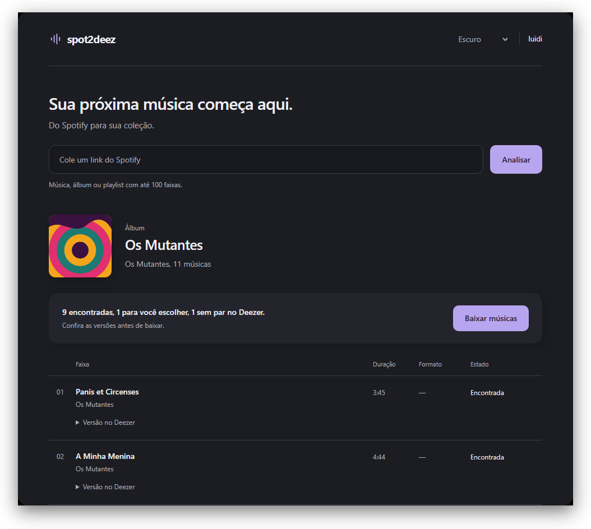
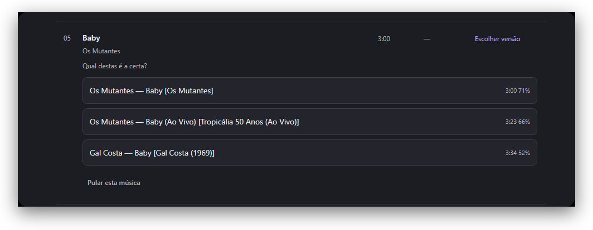

# Abul Converter

**Paste a Spotify link. Get files good enough to mix.**

<sub>Formerly spot2deez, which is still the name you will see inside the app.</sub>

<p align="center">
  
</p>

---

## Why this exists

I DJ as a hobby. Not in clubs, not at festivals: in my living room, for an audience of
one couch.

DJ software needs actual files, and they have to sound good. A 128 kbps rip falls apart the
moment it hits real speakers. The legit route is buying every track, one by one, priced in
US dollars. That makes sense if you are getting paid to play. It makes a lot less sense when
the gig is "Saturday night, at home, nobody asked".

Meanwhile all my music discovery already lives in Spotify playlists, and Spotify will
happily stream you anything but will never hand you a file.

Deezer, on the other hand, serves lossless audio. So Abul Converter is the bridge: paste a
Spotify link, it finds the same songs on Deezer, lets you check what it is unsure about,
and downloads properly tagged FLACs, ready to drop into the DJ software.

It runs on a free-tier cloud VM and a few friends use it too. That is the whole scale it
was built for, and it is on purpose.

## What it does

- **Tracks, albums and playlists.** Any `open.spotify.com` link works.
- **No Spotify login.** Metadata comes from Spotify's public embed pages, so there is no
  API key or OAuth dance.
- **A matcher that would rather ask than guess.** Spotify's public pages do not expose ISRC
  codes, so matching is done on title, artist and duration, plus track position for whole
  albums. When it is not sure, the track is marked *ambiguous* and you decide. A wrong song in
  your playlist is worse than a missing one.
- **Real files.** FLAC, MP3 320 or MP3 128 (whatever the Deezer account allows), with ID3/Vorbis
  tags, cover art, lyrics when available and an `.m3u8` for playlists.
- **Multi-user, minimal.** Each person has a login and only sees their own jobs. Everyone
  uses the owner's Deezer account by default, and can plug in their own if they want.
- **Cleans up after itself.** Files are deleted after a few hours. It is a pipe, not a library.

<p align="center">
  
</p>

## How it works

```
Spotify link
   │
   ▼
resolver ── reads the public embed page (title, artist, duration, position)
   │
   ▼
matcher ─── searches Deezer, scores candidates, flags anything doubtful
   │
   ▼
you ─────── review, uncheck, confirm
   │
   ▼
deezload ── downloads, decrypts and tags (git submodule, untouched)
   │
   ▼
one file or one .zip, served back to your browser
```

Stack: **FastAPI** on the back, **plain HTML + JS** on the front (no framework, no build step),
**Caddy** for automatic HTTPS, everything in **Docker Compose**.

## Running it

### What you need

- A **Deezer account** and its `arl` cookie (log in on deezer.com, open dev tools, copy the
  `arl` cookie). A free account only gets MP3 128; Premium unlocks FLAC.
- Python 3.13 for local dev, or Docker for a server.

### Local, for tinkering

```bash
git clone --recursive https://github.com/luigiluna/abul-converter
cd abul-converter
python -m venv .venv && source .venv/bin/activate
pip install -r requirements.txt

cp .env.example .env
# set DEFAULT_ARL=<your arl>, APP_ENV=dev and DEV_USER=me (skips the login screen)

python -m app.backend.main
# open http://127.0.0.1:8000
```

### On a server

```bash
git clone --recursive https://github.com/luigiluna/abul-converter
cd abul-converter

cp .env.example .env                           # fill DEFAULT_ARL and APP_SECRET_KEY
chmod 600 .env
cp deploy/Caddyfile.example deploy/Caddyfile   # put your domain in it

docker compose up -d --build

# there is no sign-up page; you create the accounts yourself
docker compose exec -u app app python -m app.passwd alice
```

Generate `APP_SECRET_KEY` with `python -c "import secrets; print(secrets.token_hex(32))"`.
It encrypts the ARLs users save, so changing it later logs everyone out and forgets them.

### Handy tools

```bash
python -m app.poc <spotify-url>              # dry run: resolve + match, print the result
python -m app.poc <spotify-url> --download   # same, then actually download
python -m app.diagnose                       # what your Deezer account can download
python -m pytest -q                          # tests run offline
```

## Known limits

- **Playlists stop at 100 tracks.** That is all Spotify's embed page shows. Spotify OAuth
  would lift this, and it is on the list.
- **No ISRC**, so a few tracks per playlist may need a human decision. That is the trade-off
  for not needing a Spotify login.
- Built for a few people, not a public service. There is no queue, no database and no
  sign-up page, and that is deliberate.

## Fine print

This is a personal project for personal use. Downloading music may break Deezer's terms
of service and the copyright laws where you live. Use your own account, keep the files
to yourself, and support the artists you listen to.

Downloading is done by [deezload](https://github.com/Lunatic16/deezload), included as an
unmodified submodule. Matching, the web app and everything around it live in this repo.
